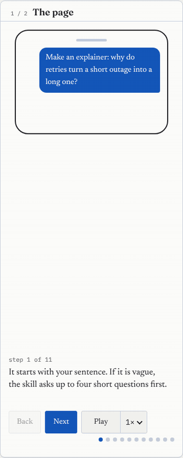

# explainers

A skill for Claude Code and Pi that turns a topic into an interactive explainer: one HTML file that anyone can open on a phone.

<p align="center"></p>

You ask for an explainer of a concept, a pull request, an incident or an onboarding topic. The agent asks up to four short questions, then writes the page:

- a question the reader can't answer yet,
- a picture that changes with every step (Back, Next, Play, and a speed control),
- one choice the reader makes, with real logic behind it,
- and a one-line answer.

Explainers are **silent by design**. Captions and pictures do the teaching, so a page works on a phone, in a PR description, or as a link in chat.

## Install

Claude Code:

```bash
/plugin marketplace add EranYonai/explainers
/plugin install explainers@explainers
```

Pi:

```bash
pi install git:github.com/EranYonai/explainers
```

## Use

Ask in plain words:

```text
Make an explainer of how a database index speeds up a query.
Explain this PR visually for the team.
```

You get `<slug>.html`, a single file with no server and no build step. Open it in a browser, send it in a chat, or drop it on any static host.

The agent checks its own page before handing it over. It walks every step at phone and desktop width and fixes what breaks.

## Building a page

The skill writes a source page that references the shared player and a theme by placeholder, then inlines them:

```bash
node skills/explainer/scripts/build.mjs page.src.html -o page.html   # one self-contained file
node skills/explainer/scripts/check.mjs page.html                    # walks every step, prints PASS or FAIL
```

Start from [`templates/page.src.html`](skills/explainer/templates/page.src.html). The player API is documented at
the top of [`player.js`](skills/explainer/templates/player.js).

## Principles

1. **Content first, engine second, platform last.** Each layer is pulled out of real use of the one before.
2. **The agent interviews before it draws.** Short, and skippable for day-to-day asks.
3. **Scenes describe states, not animations.** Each step says what is true; the player animates the change.
4. **Numbers come from code.** Every number on screen is computed by a function in the page, never typed by hand.
5. **Random things are seeded,** so captions can quote results and a video renders the same every time.
6. **Readable cold.** One topic per page, a picture from the first step, and no word the reader hasn't been given.

## Layout

```
skills/explainer/      the skill: SKILL.md, player (templates/), themes, build and check scripts
examples/              explainers made with the skill or its drafts
docs/themes/           gallery of 25 themes and the generator (the skill ships 8)
docs/findings/         field notes from the first drafts
runs.csv               a log of explainers made with the skill
```

## License

[Apache-2.0](LICENSE)
